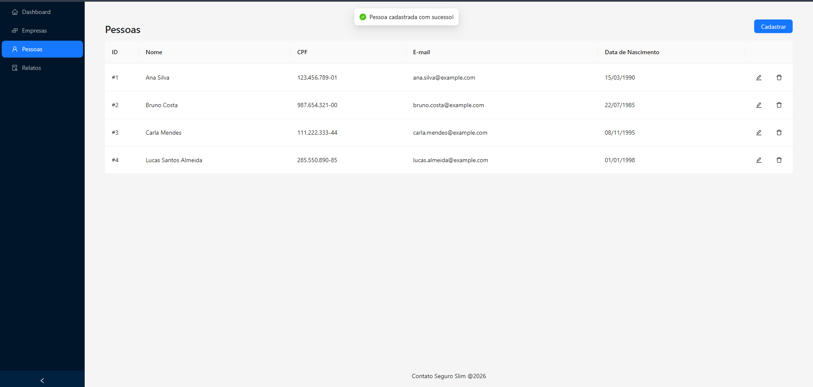
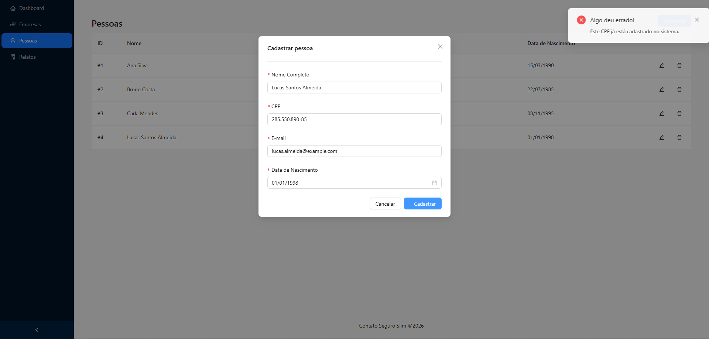
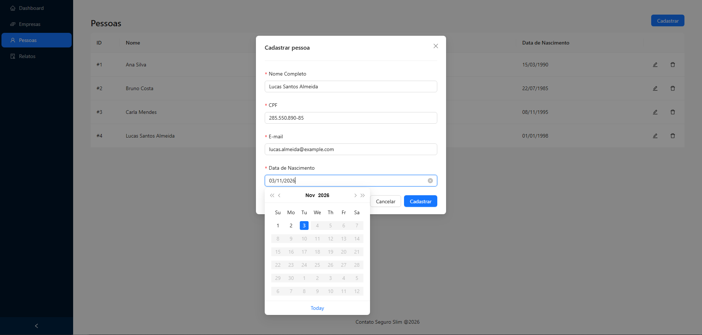
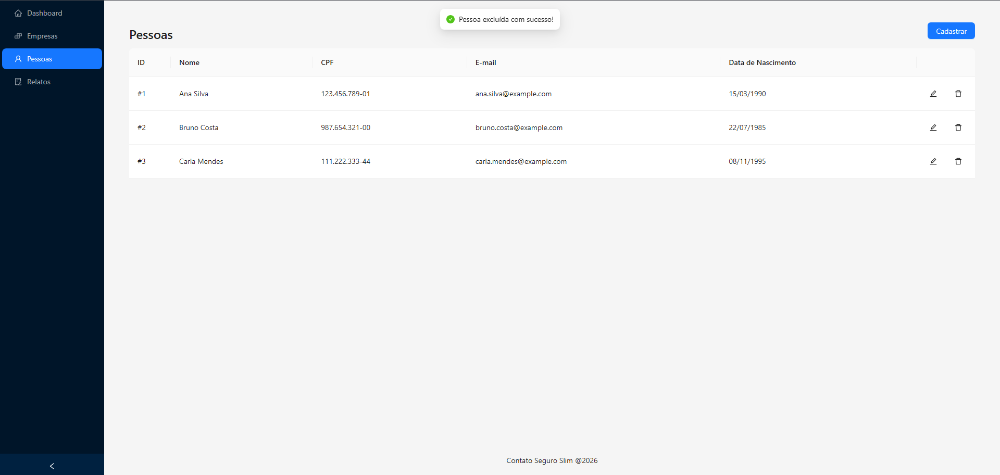
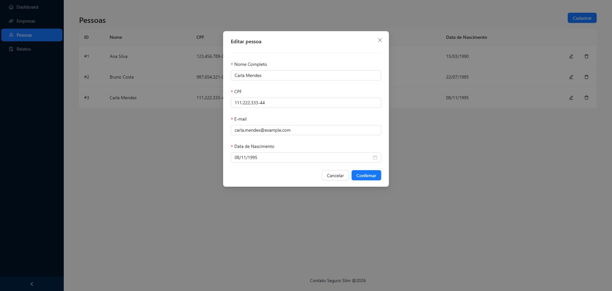
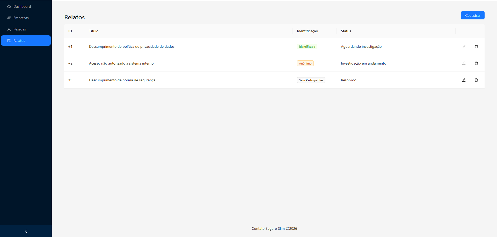
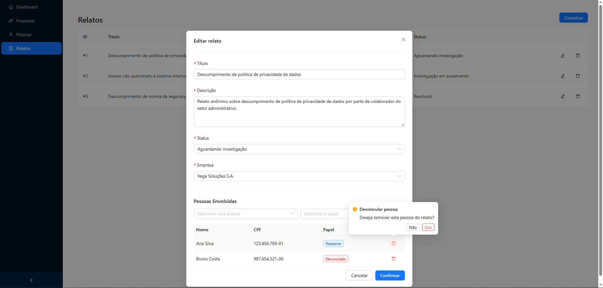
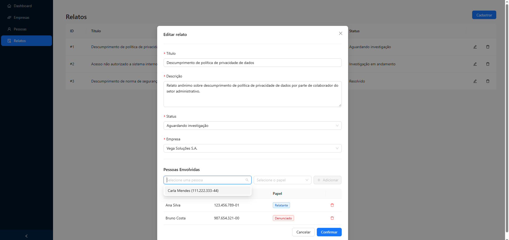
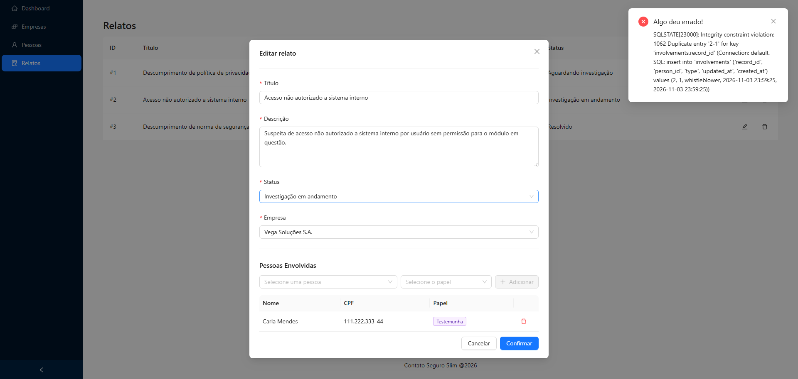

# Evidências de Testes Manuais

Este documento registra a execução dos testes manuais dos cenários descritos no [MINI_PRD.md](MINI_PRD.md) e planejados no [DESIGN_PLAN.md](DESIGN_PLAN.md), comprovando o correto funcionamento das regras de negócio e da interface.

---

## Épico 1: Gestão de Pessoas

### Cenário 1: Cadastro e Listagem de Nova Pessoa
- **O que foi testado:** Criação de um novo registro de pessoa com dados válidos e verificação de sua exibição na listagem principal.
- **Como foi testado:**
  1. Acessou-se o menu lateral **Pessoas** (`/people`);
  2. Clicou-se no botão **Cadastrar** no topo da tela;
  3. Preencheram-se os campos com dados válidos: Nome Completo, CPF (formatado dinamicamente com máscara), E-mail e Data de Nascimento;
  4. Clicou-se no botão **Cadastrar** do modal.
- **Resultado esperado:** Fechamento do modal, notificação de sucesso e inclusão imediata da nova pessoa na tabela, com CPF e data de nascimento formatados no padrão brasileiro (`000.000.000-00` e `DD/MM/YYYY`).
- **Resultado obtido:** A requisição `POST /people` respondeu com sucesso (HTTP 201), a notificação foi exibida e a lista foi atualizada exibindo o novo registro com as formatações visuais adequadas.
- **Evidência Visual:**
  

---

### Cenário 2: Validação de CPF Duplicado (HTTP 409)
- **O que foi testado:** Tentativa de cadastro de pessoa utilizando um CPF que já existe no banco de dados.
- **Como foi testado:**
  1. No módulo de **Pessoas**, clicou-se em **Cadastrar**;
  2. Informou-se um novo nome e e-mail, porém utilizou-se o mesmo CPF de uma pessoa previamente cadastrada;
  3. Submeteu-se o formulário clicando em **Cadastrar**.
- **Resultado esperado:** O backend deve rejeitar a criação retornando status HTTP 409 (Conflict). O frontend deve interceptar o erro e exibir uma notificação amigável em português: *"Algo deu errado! Este CPF já está cadastrado no sistema."*, impedindo a duplicação.
- **Resultado obtido:** A API retornou HTTP 409 e o modal exibiu a notificação de erro localizada em português, mantendo a integridade dos dados e o formulário aberto para correção.
- **Evidência Visual:**
  

---

### Cenário 3: Validação de Data de Nascimento e Máscara de CPF
- **O que foi testado:** Bloqueio de seleção de datas futuras para nascimento e funcionamento da máscara visual de CPF em tempo real.
- **Como foi testado:**
  1. Abriu-se o modal de cadastro de pessoa;
  2. Digitou-se apenas números no campo de CPF e observou-se a inserção automática de pontos e traço;
  3. Abriu-se o seletor de calendário do campo "Data de Nascimento".
- **Resultado esperado:** 
  - O campo de CPF deve aplicar a máscara `000.000.000-00` conforme a digitação e limitar a 11 dígitos numéricos;
  - Todas as datas posteriores ao dia de hoje devem estar desabilitadas (cinzas e não clicáveis) no calendário.
- **Resultado obtido:** A máscara formatou o CPF em tempo real bloqueando caracteres inválidos, e o calendário bloqueou visualmente todas as datas futuras (`disabledDate`).
- **Evidência Visual:**
  

---

### Cenário 4: Exclusão de Pessoa com Confirmação
- **O que foi testado:** Exclusão de uma pessoa cadastrada com prevenção de exclusão acidental via diálogo de confirmação.
- **Como foi testado:**
  1. Na tabela de pessoas, localizou-se o registro desejado;
  2. Clicou-se no ícone de lixeira (**Excluir**);
  3. No balão de confirmação (*"Tem certeza que deseja excluir esta pessoa?"*), validou-se as opções **Não** e **Sim**;
  4. Confirmou-se clicando em **Sim**.
- **Resultado esperado:** O pop-up de confirmação deve ser exibido evitando cliques acidentais e, após confirmação, a requisição `DELETE /people/:id` deve remover a pessoa da listagem e exibir mensagem de sucesso.
- **Resultado obtido:** Pop-up exibido perfeitamente e exclusão realizada com sucesso após confirmação.
- **Evidência Visual:**
  

---

### Cenário 5: Edição de Pessoa com Dados Pré-carregados
- **O que foi testado:** Abertura do modal de edição com os dados existentes pré-carregados (inclusive CPF com máscara) e atualização das informações.
- **Como foi testado:**
  1. Na tabela de pessoas, clicou-se no ícone de lápis (**Editar**);
  2. Verificou-se o preenchimento automático dos campos (Nome, CPF formatado, E-mail e Data de Nascimento);
  3. Modificaram-se as informações desejadas e clicou-se em **Confirmar**.
- **Resultado esperado:** Carregamento correto dos dados existentes no formulário e envio da requisição `PUT /people/:id` com atualização imediata na tabela.
- **Resultado obtido:** Dados carregados com exatidão no modal e atualização concluída com sucesso.
- **Evidência Visual:**
  

---

## Épico 2: Gestão de Envolvimentos nos Relatos

### Cenário 6: Vínculo de Envolvidos e Diferenciação de Participação e Anonimato
- **O que foi testado:** Vínculo de participantes a um relato e verificação da diferenciação visual na coluna **Identificação** (`Sem Participantes` vs `Anônimo` vs `Identificado`).
- **Como foi testado:**
  1. Acessou-se o menu **Relatos** (`/records`) e verificou-se a coluna **Identificação** exibindo a tag cinza `Sem Participantes` para relatos sem nenhuma pessoa cadastrada;
  2. Clicou-se em **Editar** um relato;
  3. Na seção **Pessoas Envolvidas**, selecionou-se uma pessoa com o papel **Testemunha** (ou Vítima/Denunciado) e clicou-se em **Adicionar**;
  4. Observou-se na tabela principal que o relato passou a ser classificado como `Anônimo` (pois possui participantes, mas nenhum relatante);
  5. Em seguida, adicionou-se uma pessoa com o papel de **Relatante** (`whistleblower`).
- **Resultado esperado:** 
  - Relatos sem nenhum envolvido exibem `Sem Participantes`;
  - Relatos com participantes, mas sem relatante, exibem a tag `Anônimo`;
  - Relatos com ao menos um relatante exibem a tag verde `Identificado`.
- **Resultado obtido:** Os 3 estados de identificação funcionaram com precisão, proporcionando clareza operacional para o membro de comitê.
- **Evidência Visual:**
  

---

### Cenário 7: Desvinculação de Envolvido do Relato
- **O que foi testado:** Remoção de um participante previamente associado ao relato através do modal de edição.
- **Como foi testado:**
  1. No modal de edição de relato, localizou-se uma pessoa na tabela da seção **Pessoas Envolvidas**;
  2. Clicou-se no botão de lixeira vermelho;
  3. No diálogo de confirmação (*"Deseja remover esta pessoa do relato?"*), confirmou-se a ação clicando em **Sim**.
- **Resultado esperado:** Disparo da requisição `DELETE /records/:recordId/involvements/:id`, mensagem de sucesso e remoção imediata da pessoa da lista de envolvidos. Caso o envolvido removido fosse o único relatante, o relato deve voltar a ser classificado como `Anônimo`.
- **Resultado obtido:** Registro removido com sucesso e status de anonimato recalculado adequadamente.
- **Evidência Visual:**
  

---

### Cenário 8: Prevenção de Duplicidade de Pessoa no Mesmo Relato
- **O que foi testado:** Mecanismo de prevenção do front-end para impedir que a mesma pessoa seja adicionada mais de uma vez ao mesmo relato (evitando erro HTTP 409).
- **Como foi testado:**
  1. Vinculou-se uma pessoa a um relato;
  2. Abriu-se novamente o seletor "Selecione uma pessoa" para adicionar mais um participante.
- **Resultado esperado:** O seletor deve filtrar e omitir as pessoas que já foram vinculadas àquele relato específico, permitindo selecionar apenas pessoas ainda não participantes.
- **Resultado obtido:** Filtro ativo com sucesso. As pessoas já vinculadas deixam de aparecer nas opções do seletor, prevenindo conflitos antes da submissão.
- **Evidência Visual:**
  

---

## 3. Limitações do Back-end

Durante os testes de integração do Épico 2, foi identificada uma nuance no comportamento do back-end (`server/`):

- **Comportamento no Cadastro (`CreateRecordModal`):**
  No fluxo de criação de relato, a associação de pessoas e papéis funciona perfeitamente, inserindo novos registros no banco sem nenhuma inconsistência.
- **Comportamento na Edição/Atualização (`EditRecordModal`):**
  Ao desvincular um participante de um relato via `DELETE /records/:recordId/involvements/:id` e, em seguida, tentar reassociar essa mesma pessoa ao mesmo relato, a API devolve o erro:
  `SQLSTATE[23000]: Integrity constraint violation: 1062 Duplicate entry '1-1' for key 'involvements.record_id'` (HTTP 500).
  *Exemplo reproduzido no Relato #2:* Vinculou-se a pessoa "Ana Silva" como Relatante e "Carla" como envolvida. Após excluí-las do relato, nenhuma das duas pôde ser adicionada novamente àquele mesmo relato devido à colisão na chave primária/única física do MySQL.
- **Evidência Visual do Erro de Back-end:**
  
- **Causa Raiz Identificada:**
  1. O model `Involvement` no PHP utiliza a trait `Illuminate\Database\Eloquent\SoftDeletes`, mantendo o registro no banco com a data preenchida na coluna `deleted_at`.
  2. No MySQL, a migração `20260610000003_involvement.php` criou um índice único composto restrito:
     ```php
     $table->addIndex(['record_id', 'person_id'], ['unique' => true]);
     ```
  3. No método `InvolvementService::create`, a verificação de existência executa `Involvement::where(...)->exists()`, que ignora registros deletados por padrão (`WHERE deleted_at IS NULL`). O Eloquent avalia que a pessoa não existe e tenta realizar o `INSERT`, colidindo com o índice único do MySQL que ainda mantém o registro soft-deleted.
- **Conduta:**
  Como a regra estrita do teste veda modificações no diretório `server/`, o comportamento foi devidamente mapeado, mantendo a integridade do código do back-end e registrando esta análise técnica como evidência.

